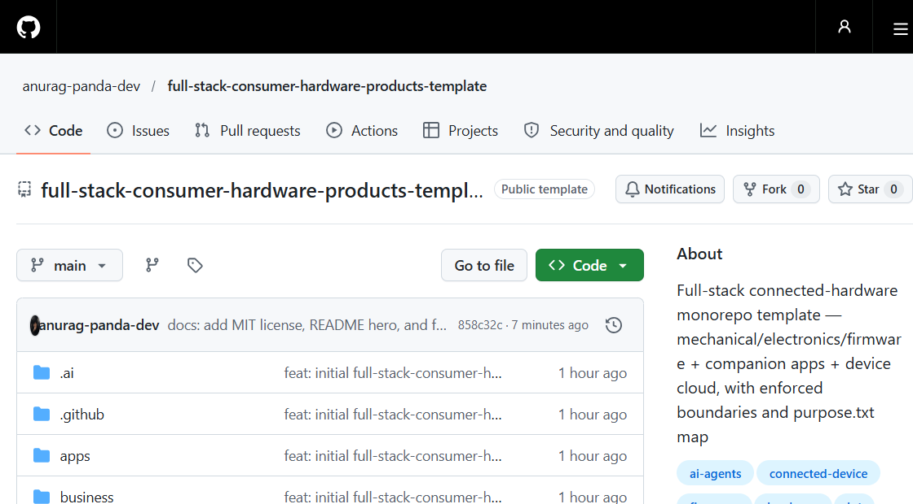

# বাংলা অনুবাদ · [English](README.md)

> **টেমপ্লেট পরিবারের অংশ** — এটি নিচের দুটির সাথে একসাথে ব্যবহার করুন:
> [`big-software-product-template`](https://github.com/anurag-panda-dev/big-software-product-template) (শুধু সফটওয়্যার) এবং
> [`consumer-hardware-products-template`](https://github.com/anurag-panda-dev/consumer-hardware-products-template) (শুধু হার্ডওয়্যার)।

<h1 align="center">ফুল-স্ট্যাক কনজিউমার হার্ডওয়্যার প্রোডাক্ট টেমপ্লেট</h1>
<p align="center"><i>Full-Stack Consumer Hardware Products Template</i></p>

<p align="center"><b>প্রতিটি ফোল্ডার নিজেকে ব্যাখ্যা করে — মানুষের কাছেও, AI এজেন্টের কাছেও।</b><br>
১৯৩টি <code>purpose.txt</code> ম্যাপ · এক রিপো, দুই জগৎ · সেমটি হলো <code>kernel/contracts</code></p>

<p align="center">
  <a href="LICENSE"></a>
  <a href="https://github.com/anurag-panda-dev/full-stack-consumer-hardware-products-template/generate"></a>
  <a href="https://github.com/anurag-panda-dev/full-stack-consumer-hardware-products-template"></a>
</p>

<p align="center">
  
</p>

```text
হার্ডওয়্যার   products/ mechanical/ electronics/ firmware/ certification/
               manufacturing/ supply-chain/ validation/ packaging/ test-tools/
                               │
           ┌───────────────────┴───────────────────┐
           │   kernel/contracts  ← সেমটি           │   ফার্মওয়্যার মেসেজ স্কিমা
           └───────────────────┬───────────────────┘   + OTA ম্যানিফেস্ট এখান থেকেই তৈরি
                               │
সফটওয়্যার   apps/ crosscutting/device-sdk/ kernel/ platform/{api,ota,telemetry}
               tests/ datasets/ content/
শেয়ারড      docs/ rfcs/ business/ legal/ labs/ sandbox/ infra/ tooling/
```

**কানেক্টেড-হার্ডওয়্যার প্রোডাক্টের** জন্য একটি মনোরিপো টেমপ্লেট: ইন্ডাস্ট্রিয়াল ডিজাইন, ইলেকট্রনিক্স ও ফার্মওয়্যার — সাথে কম্প্যানিয়ন অ্যাপ ও ডিভাইস ক্লাউড। এক রিপো, দুই জগৎ, সুস্পষ্ট সীমানা।

স্ট্রাকচারের যুক্তি: `docs/decisions/ADR-0001-Structure.md`।

## অভিজ্ঞতালব্ধ নিয়ম

| যদি এটি হয়… | এটি যাবে… |
|---|---|
| কোনো ডিভাইস প্রোডাক্ট লাইনের স্পেক/ভ্যারিয়েন্ট/রিলিজ | `products/<line>/` |
| CAD / এনক্লোজার / CMF | `mechanical/` |
| স্কিমেটিকস / PCB / পাওয়ার / RF | `electronics/` |
| বুটলোডার / ড্রাইভার / অ্যাপ ফার্মওয়্যার / ডিভাইসের OTA এজেন্ট | `firmware/` |
| কম্প্যানিয়ন অ্যাপ (মোবাইল, ওয়েব, অ্যাডমিন) | `apps/` |
| সব অ্যাপের ব্যবহৃত শেয়ারড ডিভাইস-ইন্টার‌্যাকশন কোড | `crosscutting/device-sdk` |
| ডিভাইস ক্লাউড: API, OTA সার্ভিস, টেলিমেট্রি, পেমেন্ট | `platform/` |
| পুনর্ব্যবহারযোগ্য সফটওয়্যার কোর (কন্ট্রাক্ট, ডিজাইন সিস্টেম, i18n) | `kernel/` |
| OTA রিলিজ সার্ভিস vs ডিভাইসের এজেন্ট | `platform/ota` vs `firmware/ota` |
| নির্ভরযোগ্যতা/তাপ/ব্যাটারি পরীক্ষা | `validation/` (সফটওয়্যার টেস্টের হার্ডওয়্যার সমকক্ষ) |
| ডেটা (কাঁচা → সম্পাদিত → যাচাইকৃত) | `datasets/` |
| ব্যবহারকারীর লেখা, ম্যানুয়াল লেখা, ট্রাবলশুটিং | `content/` |
| ব্যবসা ও পরিচালন | `business/` |
| জ্ঞান / সিদ্ধান্ত | `docs/` (গৃহীত) · `rfcs/` (অমীমাংসিত) |
| প্রোটোটাইপ / গবেষণা | `sandbox/` · `labs/` |

**প্রতিটি ফোল্ডারে একটি `purpose.txt` থাকে** — কোনটা ওখানে বসবে এবং কী থাকা উচিত তা বর্ণনা করে। হালনাগাদ রাখুন — এগুলোই মানচিত্র।

## স্ট্রাকচার

```text
হার্ডওয়্যার
products/         প্রতি লাইনে একটি ফোল্ডার: product.md, requirements/, variants/, release/
mechanical/       cad, industrial-design, enclosure
electronics/      pcb, power, rf, devboards
firmware/         bootloader, drivers, application, boards, ota (on-device agent)
certification/    india (BIS/WPC/TEC), international (FCC/CE), emc, safety, environment
manufacturing/    dfm, assembly, test-jigs, quality, yields
supply-chain/     bom, suppliers, costing
validation/       reliability, thermal, battery, drop-vibration, emc-prescan
packaging/        dieline, inserts, labels
test-tools/       jig firmware, flash tools, calibration

সফটওয়্যার
apps/             web, admin, mobile (RN ⇄ Flutter, stack-neutral)
crosscutting/     device-sdk (provisioning, protocol, sync)
kernel/           design-system, contracts, auth, offline, i18n, entitlements, telemetry, config
platform/         api (stack-neutral), ota (releases/channels/rollback), telemetry, notifications,
                  payments, jobs, identity, database, observability
tests/            e2e · contract · visual
datasets/         raw → curated → schemas → sources → pipelines
content/          templates, workflow, library (guides/troubleshooting/manuals/faqs), locale, seo

শেয়ারড
docs/  rfcs/  business/  legal/  labs/  sandbox/  infra/  tooling/  security/  .ai/  AGENTS.md
```

## সীমানা নিয়ম (দেখুন PACKAGE.md)

1. `apps/*` → `crosscutting/*`, `kernel/*`, `platform` কন্ট্রাক্ট — **কখনোই** `platform/*`-এর অভ্যন্তরীণ বিষয় বা সরাসরি হার্ডওয়্যার ফোল্ডার নয়
2. `crosscutting/*` → শুধু `kernel/*`
3. `platform/*` → তার উপরে থেকে কিছু কখনো ইমপোর্ট করে না (যোগাযোগ হয় `platform/api/openapi` + `kernel/contracts` দিয়ে)
4. `kernel/contracts` ডেটা শেপের একমাত্র সত্যসূত্র — ফার্মওয়্যার মেসেজ স্কিমা ও OTA ম্যানিফেস্ট ফরম্যাটও এখান থেকেই তৈরি হয়
5. ফার্মওয়্যার কখনো সরাসরি ক্লাউড ডাকে না — শুধু নথিভুক্ত প্রোটোকলের মাধ্যমে (`firmware/` ↔ `platform/telemetry|ota`)
6. `products/<line>/`-এ থাকে স্পেক + লিংক, আর্টিফ্যাক্টের কপি কখনো নয়
7. `logic/` ফ্রেমওয়ার্ক-মুক্ত থাকে; জেনারেটেড আউটপুট (Gerber/STEP/এক্সপোর্ট) কখনো হাতে সম্পাদনা করা হয় না
8. কর্পোরেট ডকুমেন্ট (ইকুইটি, HR, স্বাক্ষরিত চুক্তি, IP ফাইলিং) রাখা হয় একটি **প্রাইভেট company-ops রিপোতে**, কখনো এখানে নয়

## এই টেমপ্লেট ব্যবহার করা

1. GitHub-এ **এই টেমপ্লেটটি ব্যবহার করুন** (অথবা `gh repo create my-project --template anurag-panda-dev/full-stack-consumer-hardware-products-template`)
2. **নাম বদলান** — রুট `README.md`, `purpose.txt`, `AGENTS.md` হালনাগাদ করুন
3. **`products/example-device/`** বাদ দিয়ে নিজের প্রকৃত প্রোডাক্ট লাইন বসান
4. **সফটওয়্যার ওয়ার্কস্পেস পূরণ করুন** — `package.json`, `pnpm-workspace.yaml`, `turbo.json`, `tsconfig.base.json` (রুট `purpose.txt`-এ তালিকাভুক্ত; টেমপ্লেটটি স্ট্যাক-ফ্লেক্সিবল থাকায় ইচ্ছাকৃতভাবে দেওয়া হয় না — `platform/api`-এর Express ⇄ FastAPI আর `apps/mobile`-এর RN ⇄ Flutter-ও একইভাবে)
5. **প্রথম সিদ্ধান্তটি লিখে রাখুন** — `docs/decisions/TEMPLATE.md` কপি করে → `ADR-0001-…`; বড় সিদ্ধান্ত আগে `rfcs/` দিয়ে যায়
6. **খালি স্ক্যাফোল্ডিং আগে থেকে বানাবেন না** — আসল কাজ এলে ফোল্ডার পূরণ হয়
