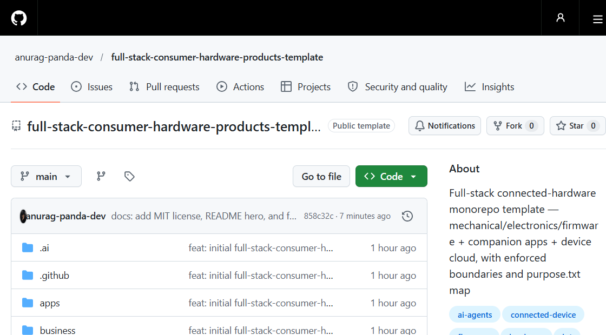

> 🌐 **English** · [বাংলা](README.bn.md)

> **Part of a template family** — use alongside
> [`big-software-product-template`](https://github.com/anurag-panda-dev/big-software-product-template) (software only) and
> [`consumer-hardware-products-template`](https://github.com/anurag-panda-dev/consumer-hardware-products-template) (hardware only).

<h1 align="center">Full-Stack Consumer Hardware Products Template</h1>

<p align="center"><b>Every folder explains itself — to humans and to AI agents.</b><br>
193 <code>purpose.txt</code> maps · one repo, two worlds · the seam is <code>kernel/contracts</code></p>

<p align="center">
  <a href="LICENSE"></a>
  <a href="https://github.com/anurag-panda-dev/full-stack-consumer-hardware-products-template/generate"></a>
  <a href="https://github.com/anurag-panda-dev/full-stack-consumer-hardware-products-template"></a>
</p>

<p align="center">
  
</p>

```text
HARDWARE   products/ mechanical/ electronics/ firmware/ certification/
           manufacturing/ supply-chain/ validation/ packaging/ test-tools/
                        │
       ┌────────────────┴────────────────┐
       │   kernel/contracts  ← THE SEAM  │   firmware message schemas
       └────────────────┬────────────────┘   + OTA manifest derive from here
                        │
SOFTWARE   apps/ crosscutting/device-sdk/ kernel/ platform/{api,ota,telemetry}
           tests/ datasets/ content/
SHARED     docs/ rfcs/ business/ legal/ labs/ sandbox/ infra/ tooling/
```

A monorepo template for **connected-hardware products**: industrial design, electronics, and firmware **plus** companion apps and the device cloud — one repo, two worlds, explicit boundaries.

Structure rationale: `docs/decisions/ADR-0001-Structure.md`.

## Rules of thumb

| If it is… | It goes in… |
|---|---|
| A device product line's specs/variants/releases | `products/<line>/` |
| CAD / enclosure / CMF | `mechanical/` |
| Schematics / PCB / power / RF | `electronics/` |
| Bootloader / drivers / app firmware / on-device OTA agent | `firmware/` |
| Companion app (mobile, web, admin) | `apps/` |
| Shared device-interaction code used by all apps | `crosscutting/device-sdk` |
| Device cloud: API, OTA service, telemetry, payments | `platform/` |
| Reusable software core (contracts, design system, i18n) | `kernel/` |
| OTA release service vs on-device agent | `platform/ota` vs `firmware/ota` |
| Reliability/thermal/battery testing | `validation/` (hardware analog of software tests) |
| Data (raw → curated → verified) | `datasets/` |
| User-facing copy, manuals copy, troubleshooting | `content/` |
| Business & operations | `business/` |
| Knowledge / decisions | `docs/` (landed) · `rfcs/` (pending) |
| Prototype / research | `sandbox/` · `labs/` |

**Every folder contains a `purpose.txt`** — what belongs there and what it should hold. Keep them updated; they are the map.

## Structure

```text
HARDWARE
products/         one folder per line: product.md, requirements/, variants/, release/
mechanical/       cad, industrial-design, enclosure
electronics/      pcb, power, rf, devboards
firmware/         bootloader, drivers, application, boards, ota (on-device agent)
certification/    india (BIS/WPC/TEC), international (FCC/CE), emc, safety, environment
manufacturing/    dfm, assembly, test-jigs, quality, yields
supply-chain/     bom, suppliers, costing
validation/       reliability, thermal, battery, drop-vibration, emc-prescan
packaging/        dieline, inserts, labels
test-tools/       jig firmware, flash tools, calibration

SOFTWARE
apps/             web, admin, mobile (RN ⇄ Flutter, stack-neutral)
crosscutting/     device-sdk (provisioning, protocol, sync)
kernel/           design-system, contracts, auth, offline, i18n, entitlements, telemetry, config
platform/         api (stack-neutral), ota (releases/channels/rollback), telemetry, notifications,
                  payments, jobs, identity, database, observability
tests/            e2e · contract · visual
datasets/         raw → curated → schemas → sources → pipelines
content/          templates, workflow, library (guides/troubleshooting/manuals/faqs), locale, seo

SHARED
docs/  rfcs/  business/  legal/  labs/  sandbox/  infra/  tooling/  security/  .ai/  AGENTS.md
```

## Boundary rules (see PACKAGE.md)

1. `apps/*` → `crosscutting/*`, `kernel/*`, `platform` contracts — **never** `platform/*` internals or hardware folders directly
2. `crosscutting/*` → `kernel/*` only
3. `platform/*` → never imported by anything above it (communicates via `platform/api/openapi` + `kernel/contracts`)
4. `kernel/contracts` is the single source of truth for data shapes — it also drives firmware message schemas and the OTA manifest format
5. Firmware never calls the cloud directly except through the documented protocol (`firmware/` ↔ `platform/telemetry|ota`)
6. `products/<line>/` holds specs + links, never copies of artifacts
7. `logic/` stays framework-free; generated outputs (Gerber/STEP/exports) are never hand-edited
8. Corporate documents (equity, HR, signed contracts, IP filings) belong in a **private company-ops repo**, never here

## Using this template

1. **Use this template** on GitHub (or `gh repo create my-project --template anurag-panda-dev/full-stack-consumer-hardware-products-template`)
2. **Rename** — update root `README.md`, `purpose.txt`, `AGENTS.md`
3. **Replace `products/example-device/`** with your real product line
4. **Fill the software workspace** — `package.json`, `pnpm-workspace.yaml`, `turbo.json`, `tsconfig.base.json` (listed in root `purpose.txt`; deliberately not shipped so the template stays stack-flexible — same for `platform/api` Express ⇄ FastAPI and `apps/mobile` RN ⇄ Flutter)
5. **Record your first decision** — copy `docs/decisions/TEMPLATE.md` → `ADR-0001-…`; big choices go through `rfcs/` first
6. **Do not pre-create empty scaffolding** — folders fill as real work arrives
